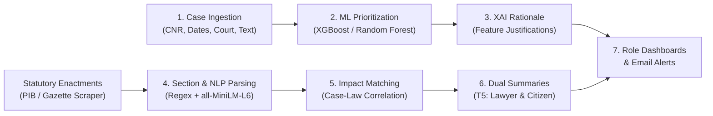

# NyaySetu – Proactive Legal Insights & Case Prioritization System

NyaySetu ("Bridge to Justice") is an AI-driven judicial decision-support platform designed for the Indian judiciary. It addresses judicial backlog, expedites case scheduling, and eliminates legal information asymmetry through explainable AI (XAI) models.

---

## 📖 What is NyaySetu?

**NyaySetu** (derived from the Sanskrit words *Nyay* meaning "Justice" and *Setu* meaning "Bridge") is an intelligent decision-support platform built to modernize court case management in India.

In India's legal ecosystem, over **40 million cases** remain pending across District Courts, High Courts, and the Supreme Court. At the same time, rapid legislative updates—such as the transition to the *Bharatiya Nyaya Sanhita (BNS)*, the *Digital Personal Data Protection (DPDP) Act*, and statutory bail reforms—frequently alter procedural and substantive rights. Legal practitioners and judges often face delays in discovering how new enactments impact ongoing trials, while ordinary citizens struggle with complex legal jargon.

NyaySetu acts as a technological bridge that:
- **Assists Judges** in managing daily dockets by highlighting cases requiring urgent intervention (e.g., long-term undertrial detentions, time-sensitive bail pleas, or injunctions).
- **Equips Lawyers** with early-warning statutory alerts, detailing how newly enacted laws or amendments affect their ongoing active matters.
- **Empowers Citizens** by breaking down intricate legal provisions into transparent, simple, and rights-focused summaries.

---

## ⚙️ How NyaySetu Works (Step-by-Step Workflow)



### 1. Case Ingestion & Feature Engineering
- Court records (metadata, filing dates, hearing counts, evidence records, and descriptions) are ingested into the platform.
- The system extracts key urgency factors—such as applications for bail, arrest without notice, injunctions, and stage of proceedings (Trial vs. Appeal).

### 2. Intelligent Case Prioritization
- The feature vector is processed through an ML prioritization pipeline (trained on 1,000,000+ judicial case records).
- Each case receives a normalized **Priority Score** ($0.0 - 1.0$) and a categorical classification: **High**, **Medium**, or **Low**.
- Factors include pendency age, hearing density, evidence volume, court tier weighting, and societal sensitivity.

### 3. Transparent Explainability (XAI)
- Rather than providing an opaque score, the Explainable AI (XAI) module generates a plain-text rationale for judges explaining *why* the case has been prioritized (e.g., highlighting that an undertrial has spent more than 14 months in custody for a non-heinous crime).

### 4. Statutory Ingestion & Semantic Section Extraction
- The platform scans legislative releases from the Gazette of India, Press Information Bureau (PIB), and Ministry of Law repositories.
- Statutory text is processed with regular-expression rule engines to extract precise citations (e.g., *Section 41A CrPC*, *Section 61 BNS*, *Article 21*).
- Dense semantic vector embeddings (384-dimensional) are generated via `sentence-transformers/all-MiniLM-L6-v2`.

### 5. Case-Law Correlation & Impact Scoring
- The **Impact Engine** cross-references new statutory amendments against active case records using a weighted scoring matrix:
  - **Statute Section Match (+40)**: Matches extracted sections between the new law and the case.
  - **Semantic Cosine Alignment (+30)**: Measures linguistic similarity between statutory text and case issues.
  - **Procedural Stage (+15 / +10)**: Prioritizes appeals and active trials.
  - **Category Weight (+10)**: Categorizes Criminal, Labour, Commercial, Technology, or Civil matters.
  - **Social Sensitivity (+5)**: Accounts for societal impact.

### 6. Dual-Perspective Summarization (T5 Transformer)
- To ensure every stakeholder understands the legal effect, the NLP summarization engine produces two distinct outputs:
  - **Technical Lawyer View**: Focuses on legal procedure, evidentiary changes, shift in burden of proof, and case precedents.
  - **Simplified Citizen View**: Written in clear, non-technical language to explain rights protections and court progress.

### 7. Real-Time Alerts & Role-Specific Portals
- High-priority cases and statutory alerts are surfaced across dedicated portals for Judges, Lawyers, and Citizens.
- Critical statutory impact briefs can be dispatched directly to verified email addresses via SMTP.

---

## 📌 Table of Contents
- [What is NyaySetu?](#-what-is-nyaysetu)
- [How NyaySetu Works](#️-how-nyaysetu-works-step-by-step-workflow)
- [Executive Overview](#-executive-overview)
- [System Architecture](#️-system-architecture)
- [Core Functional Modules](#-core-functional-modules)
  - [1. Case Prioritization Engine](#1-case-prioritization-engine)
  - [2. Proactive Law Impact Analyzer](#2-proactive-law-impact-analyzer)
  - [3. Stakeholder Notification System](#3-stakeholder-notification-system)
- [Technology Stack](#-technology-stack)
- [Role-Based Access Control (RBAC)](#-role-based-access-control-rbac)
- [Database Schema & Data Models](#️-database-schema--data-models)
- [REST API Reference](#-rest-api-reference)
- [Quick Start & Setup](#-quick-start--setup)
  - [Zero-Dependency In-Memory Mode](#zero-dependency-in-memory-mode)
  - [Running the Services](#running-the-services)
- [Legal, Ethical & Safety Constraints](#️-legal-ethical--safety-constraints)
- [Future Roadmap](#️-future-roadmap)

---

## ⚖️ Executive Overview

The Indian judicial system faces a pendency docket exceeding 40 million cases across District, High, and Supreme Courts. Concurrently, new legislative enactments, statutory amendments (such as the Bharatiya Nyaya Sanhita, DPDP Act, and procedural bail reforms), and precedent rulings are enacted continuously, creating an information lag for ongoing trials.

NyaySetu bridges these gaps by providing:
1. **Intelligent Case Prioritization**: Evaluates case pendency, urgency indicators, hearing density, and societal sensitivity to assign explainable priority rankings (High / Medium / Low).
2. **Proactive Law Impact Analysis**: Continuously scans legislative gazettes and dynamically flags pending cases affected by new statutory developments.
3. **Dual-Perspective Legal Explanations**: Generates technical summaries for judges and lawyers, while translating complex legal jargon into plain language for citizens.

---

## 🏗️ System Architecture

```
┌─────────────────────────────────────────────────────────────────────────┐
│              Presentation Layer (React 18 + Vite 4 + Tailwind CSS)      │
│     ┌───────────────────┬───────────────────┬─────────────────────┐     │
│     │   Judge Portal    │   Lawyer Portal   │   Citizen Portal    │     │
│     └───────────────────┴───────────────────┴─────────────────────┘     │
└────────────────────────────────────┬────────────────────────────────────┘
                                     │ HTTP / REST (JWT Auth)
┌────────────────────────────────────▼────────────────────────────────────┐
│                    Application API Layer (Flask REST API)               │
│   /api/auth          /api/cases          /api/laws       /api/notifs    │
└─────────┬──────────────────────────┬──────────────────────────┬─────────┘
          │                          │                          │
┌─────────▼──────────────┐ ┌─────────▼──────────────┐ ┌─────────▼─────────┐
│ Prioritization Engine  │ │  Law Impact Analyzer   │ │  Persistence Layer│
│  - XGBoost Regressor   │ │  - all-MiniLM-L6-v2    │ │  - MongoDB Atlas  │
│  - Random Forest       │ │  - T5 Summarizer       │ │  - In-Memory      │
│  - Feature Vectors     │ │  - Regex Section Match │ │    (mongomock)    │
│  - Explainable Rationale│ │  - Category Overlap    │ │  - Celery / Redis │
└────────────────────────┘ └────────────────────────┘ └───────────────────┘
```

---

## 🧠 Core Functional Modules

### 1. Case Prioritization Engine
- **Inference Service**: `backend/app/services/ml_service.py`
- **Trained Model & Encoder**: `backend/ml_models/priority_model.joblib`, `le_case_type.joblib`
- **Evaluation Baseline** (Validated across 1,057,127 records):
  - **Random Forest**: Macro F1 = 0.5875, Accuracy = 76.60%, Recall on High-Priority Cases = 77.90% (Zero urgent cases missed).
  - **XGBoost**: Macro F1 = 0.5817, RMSE = 0.0923, Accuracy = 77.46%.

#### Feature Engineering Formula
$$\text{Priority Score} = f(\text{Pendency}, \text{Urgency Boost}, \text{Evidence Count}, \text{Hearing Count}, \text{Court Tier}, \text{Social Sensitivity})$$

- **Pendency Score**: Time elapsed since filing: $\text{years\_pending} = \frac{\text{today} - \text{filing\_date}}{365.25}$
- **Urgency Boost**: Dynamic text scanning:
  - Bail, custody, arrest $\rightarrow +0.10$
  - Injunction, stay order, emergency relief $\rightarrow +0.08$
- **Evidence & Hearing Weights**: Evidence count ($\times 0.02$) and hearing frequency ($\times 0.015$).
- **Court Multiplier**: Supreme Court ($1.25\times$), High Court ($1.15\times$), Sessions/District ($1.0\times$).
- **Explainability (XAI)**: Generates humanized rationales explaining why a case received its specific score (e.g., prolonged undertrial incarceration in non-heinous offenses vs. standard civil discovery).

---

### 2. Proactive Law Impact Analyzer
- **Inference Service**: `backend/app/services/impact_service.py`
- **NLP Pipelines**: `backend/app/services/nlp_service.py`
- **Crawler**: `backend/app/services/scraper_service.py` (PIB & India Code crawlers)

#### Weighted Impact Scoring Matrix (SRS-Compliant)
| Factor | Weight | Evaluation Method |
| :--- | :---: | :--- |
| **Statute Section Match** | **+40** | Exact regex extraction (`Section \d+[A-Z]*`, `Article \d+`) matched against case text |
| **Semantic Similarity** | **+30** | Cosine similarity using `sentence-transformers/all-MiniLM-L6-v2` embeddings |
| **Court Stage** | **+15 / +10** | $+15$ for `Appeal` stage; $+10$ for `Trial` stage |
| **Offense Classification**| **+10** | Criminal / Penal / Bail classifications |
| **Social Sensitivity** | **+5** | Sensitivity score $> 5$ on a 1–10 index |

#### Dual-Perspective Summaries (XAI via T5-Small)
- **Lawyer Perspective**: Rigorous, section-specific analysis detailing evidentiary admissibility changes, shifts in burden of proof, and statutory procedural mandates.
- **Citizen Perspective**: Clear, non-technical explanations describing real-world impact, rights protections (e.g., Article 21, mandatory notices before arrest), and hearing schedules.

---

### 3. Stakeholder Notification System
- **Service**: `backend/app/services/email_service.py` & `backend/app/tasks/ai_tasks.py`
- Dispatches role-specific email briefs when statutory amendments impact cases on a lawyer's docket.
- Background synchronization using Celery periodic tasks (`crontab`) for recurring law updates.

---

## 💻 Technology Stack

| Layer | Technologies |
| :--- | :--- |
| **Frontend** | React 18, Vite 4, Tailwind CSS, Framer Motion, Chart.js, Lucide Icons |
| **Backend API** | Flask 2.x, Flask-JWT-Extended, Flask-CORS, Gunicorn |
| **AI / NLP** | PyTorch, Hugging Face Transformers (`all-MiniLM-L6-v2`, `t5-small`), Scikit-Learn, XGBoost |
| **Database & ORM** | MongoDB Atlas, MongoEngine ODM, `mongomock` (Zero-dependency in-memory mode) |
| **Task Queue** | Celery 5.6, Redis, In-process eager task execution fallback |
| **Scraping & Email**| BeautifulSoup4, Requests, Python smtplib (MIME multipart) |

---

## 👥 Role-Based Access Control (RBAC)

| Role | Access & Capabilities |
| :--- | :--- |
| **👨‍⚖️ Judge** | Full case docket management, priority overrides, direct statutory act ingestion, global analytics. |
| **⚖️ Lawyer** | View affected active cases, review technical legal impact summaries, 1-click email dispatch of briefs. |
| **👤 Citizen**| Simplified plain-language case tracker, transparency metrics, rights-focused legal explanations. |

---

## 🗄️ Database Schema & Data Models

### 1. `users`
- `username`: String (Unique)
- `email`: Email (Unique)
- `password_hash`: String (Hashed)
- `role`: Enum (`judge`, `lawyer`, `citizen`)
- `full_name`, `phone`, `is_active`, `created_at`

### 2. `cases`
- `case_number`, `case_type`, `title`, `description`, `filing_date`
- `court_type`: Enum (`Supreme Court`, `High Court`, `District Court`, `Session Court`)
- `court_name`, `high_court_name`, `stage` (`Pre-trial`, `Trial`, `Appeal`, `Judgment`)
- `urgency` (`High`, `Medium`, `Low`), `number_of_evidence`, `hearing_count`, `social_sensitivity`
- `priority_score`: Float ($0.0 - 1.0$), `predicted_priority`: String, `priority_reasoning`: Text
- `impact_reports`: List of embedded `LawImpact` documents:
  - `precedent_title`, `precedent_citation`, `relevance_score`, `impact_level`, `impact_explanation`, `section_matches`
- `lawyer`: Reference to `User`, `citizen`: Reference to `User`

### 3. `laws`
- `title`, `description`, `full_text`
- `lawyer_summary`: Technical statutory synthesis
- `citizen_summary`: Plain-English rights overview
- `impact_reasoning`, `sections`: List of strings (e.g. `["Section 41A", "Article 21"]`)
- `category`, `effective_date`, `scraped_source`
- `affecting_cases`: List of Case IDs, `affected_count`: Integer

### 4. `notifications`
- `user`: Reference to `User`, `title`, `message`, `type` (`LawImpact`, `System`, `CaseUpdate`), `read`, `link_to_id`, `created_at`

---

## 📡 REST API Reference

### Authentication (`/api/auth`)
- `POST /api/auth/register` – Register a new user profile.
- `POST /api/auth/login` – User authentication endpoint.

### Case Management (`/api/cases`)
- `GET /api/cases` – List paginated cases with JIT priority calculations (`?page=1&per_page=20&status=Pending`).
- `POST /api/cases` – File a new case (Judges and Lawyers only).
- `GET /api/cases/stats` – Global docket KPI metrics, court-tier distribution, and priority charts.

### Law Impact Analysis (`/api/laws`)
- `GET /api/laws` – Retrieve all registered statutory enactments and affected case counts.
- `GET /api/laws/<id>` – Retrieve comprehensive enactment details, full text, and mapped active cases.
- `POST /api/laws` – Ingest new statutory act and trigger semantic impact matching (Judge only).
- `POST /api/laws/<id>/email` – Dispatch formatted impact report to verified email.

### Notifications (`/api/notifications`)
- `GET /api/notifications` – Fetch user-specific notifications.
- `POST /api/notifications/read-all` – Mark all alerts as read.

---

## 🚀 Quick Start & Setup

### Prerequisites
- Python 3.9+
- Node.js 18+ and npm

### Installation
```bash
# Clone the repository
git clone https://github.com/Rakhii24/NyaySetuu.git
cd NyaySetuu

# Install backend dependencies
python -m pip install -r backend/requirements.txt

# Install frontend dependencies
cd frontend && npm install && cd ..
```

### Running the Services
Start all services (Flask API, Celery Worker, and Vite Frontend) with a single command:
```bash
python start_all.py
```
- **Web UI**: [http://localhost:3000](http://localhost:3000)
- **API Endpoint**: [http://localhost:5000](http://localhost:5000)

### Role Selection on Login
The web application provides dedicated role-switching controls (Judge, Lawyer, Citizen) directly on the authentication portal for seamless demonstration and testing of role-specific workflows.

### Zero-Dependency In-Memory Mode
If an external MongoDB Atlas cluster or Redis instance is not configured in `backend/.env`, NyaySetu **automatically falls back** to an in-memory database (`mongomock`) with synchronous eager task processing. It pre-seeds demo accounts, statutory acts, and multidimensional court cases out-of-the-box.

---

## 🛡️ Legal, Ethical & Safety Constraints

- **Assistive Support**: NyaySetu does not render legal judgments, replace human judges, or predict case outcomes as final verdicts.
- **Explainability Mandatory**: Black-box scoring is strictly prohibited. Every recommendation includes textual justifications.
- **Data Privacy**: Compliant with Indian legal ethics, data privacy principles, and judicial secrecy guidelines.

---

## 🗺️ Future Roadmap

1. **Vector Database Integration**: Migration to Milvus / Qdrant for sub-millisecond semantic search across millions of statute paragraphs.
2. **Multi-Lingual Citizen Support**: Integration with the Government of India **Bhashini** AI API for regional language translations (Hindi, Bengali, Marathi, Tamil, Telugu, etc.).
3. **Automated NJDG Sync**: Real-time docket synchronization via court CNR numbers directly from the National Judicial Data Grid.
4. **OCR & FIR Ingestion**: Computer vision pipelines for ingesting scanned charge-sheets and handwritten police FIRs.
